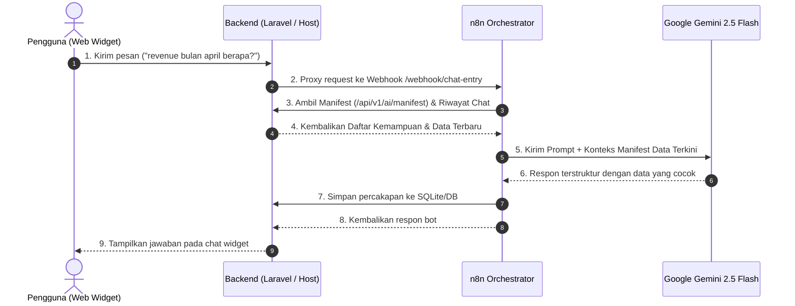

# 📘 MANUAL INTEGRASI & PANDUAN PENGEMBANGAN UNIVERSAL CHATBOT

Panduan lengkap arsitektur, integrasi, dan cara mendaftarkan API baru agar AI Chatbot dapat membaca dan menyajikan data dari aplikasi Anda.

---

## 🧠 1. Konsep Arsitektur: Manifest-Driven AI Capability

Universal Chatbot ini menggunakan arsitektur **Manifest-Driven Capabilities** yang menghubungkan Frontend Web, Orkestrator n8n, Google Gemini (LLM), dan Backend Host (Laravel/PHP).



### Mengapa AI Menjawab *"Tidak memiliki data spesifik..."* jika belum didaftarkan?
AI tidak membaca database Anda secara langsung tanpa izin. AI **hanya mengetahui informasi dan endpoint yang didaftarkan pada Manifest** (`/api/v1/ai/manifest` atau `config/ai_registry.php`).

Ketika Anda bertanya tentang data yang belum didaftarkan (misalnya data revenue bulanan):
- AI memeriksa manifest dan tidak menemukan informasi mengenai bulan tersebut.
- AI secara jujur menjawab bahwa data spesifik tersebut belum tersedia.
- **Solusinya**: Cukup daftarkan endpoint/data baru tersebut di `config/ai_registry.php` dan `routes/api.php`!

---

## 🛠️ 2. Cara Cepat: Menggunakan Bash Script Registrasi API

Tersedia script otomatis **`register-ai-capability.sh`** sehingga Anda tidak perlu mengedit `config/ai_registry.php` secara manual:

### A. Mode Interaktif (Tanya-Jawab di Terminal)
Cukup jalankan script di root project backend Anda:
```bash
./register-ai-capability.sh
```
Script akan menanyakan nama action, endpoint path, deskripsi, dan contoh data secara interaktif.

### B. Mode CLI / Satu Baris Perintah
Anda juga bisa mendaftarkan endpoint langsung via argumen:
```bash
./register-ai-capability.sh \
  --action="get_best_sellers" \
  --method="GET" \
  --path="/api/v1/store/best-sellers" \
  --desc="Melihat daftar produk paling laris di toko" \
  --data='[{"product": "Smartwatch", "price": "$120", "orders": 142}]'
```

Script akan:
1. Otomatis memvalidasi dan memodifikasi `config/ai_registry.php` tanpa merusak sintaks PHP.
2. Memperbarui (*update*) jika action sudah ada, atau menambahkan (*append*) jika baru.
3. Melakukan linting validasi sintaks PHP (`php -l`).
4. Seketika itu juga AI Gemini via n8n langsung mengenali data baru tersebut!

---

## 📝 3. Cara Manual: Mendaftarkan API Baru

Jika Anda lebih memilih mendaftarkan secara manual:

### Langkah 1: Buat Endpoint Data di Backend (`routes/api.php`)

Pastikan endpoint dilindungi middleware `VerifyInternalApiKey`:

```php
Route::middleware([VerifyInternalApiKey::class])->prefix('v1')->group(function () {

    // Contoh: Endpoint data performa revenue bulanan
    Route::get('/store/revenue/monthly', function () {
        return response()->json([
            'status' => 'success',
            'data' => [
                'Jan' => ['orders' => 34, 'earnings' => '$89.25k', 'refunds' => 8],
                'Feb' => ['orders' => 65, 'earnings' => '$98.58k', 'refunds' => 12],
                'Mar' => ['orders' => 46, 'earnings' => '$68.74k', 'refunds' => 7],
                'Apr' => ['orders' => 68, 'earnings' => '$108.87k', 'refunds' => 17],
                // ... bulan lainnya
            ]
        ]);
    });

});
```

### Langkah 2: Daftarkan ke Manifest (`config/ai_registry.php`)

Tambahkan entri baru ke dalam array `'endpoints'`:

```php
return [
    'endpoints' => [
        // ... endpoint yang sudah ada

        [
            'action' => 'get_monthly_revenue',
            'method' => 'GET',
            'path' => '/api/v1/store/revenue/monthly',
            'description' => 'Melihat rincian performa revenue, pendapatan/earnings, jumlah pesanan, dan refund bulanan (Januari s/d Desember)',
            'params' => ['month', 'year'],
            'current_data' => [
                'Jan' => ['orders' => 34, 'earnings' => '$89.25k', 'refunds' => 8],
                'Apr' => ['orders' => 68, 'earnings' => '$108.87k', 'refunds' => 17],
                'Nov' => ['orders' => 63, 'earnings' => '$88.51k', 'refunds' => 12],
                // Data snapshot ini langsung dibaca Gemini dari manifest
            ]
        ],
    ],
];
```

> [!TIP]
> **Tanpa Sentuh n8n!** 
> Begitu `config/ai_registry.php` disimpan, n8n dan Gemini secara otomatis langsung mengetahui kapabilitas baru ini pada query berikutnya. Anda tidak perlu merestart atau mengedit n8n workflow.

---

## ⚡ 3. Menjalankan Laravel Natively (Penting: Pencegahan Deadlock)

Jika Anda menjalankan Laravel secara native di host lokal menggunakan `php artisan serve`:

### Masalah Single-Worker Deadlock
Secara default, `php artisan serve` hanya berjalan dengan 1 worker (single-threaded).
1. Widget mengirim request ke Laravel `/api/webhook/chat-entry`.
2. Laravel menahan koneksi dan menghubungi n8n.
3. n8n menghubungi balik Laravel `/api/v1/ai/manifest`.
4. Karena worker Laravel sedang sibuk menunggu n8n, request balik dari n8n tertahan (*deadlock* hingga timeout 60 detik).

### Solusi:
Jalankan `php artisan serve` dengan multi-worker dan flag `--no-reload`:

```bash
PHP_CLI_SERVER_WORKERS=4 php artisan serve --host=0.0.0.0 --port=8088 --no-reload
```

*Catatan: Flag `--no-reload` wajib disertakan agar PHP CLI mengaktifkan multi-process worker.*

---

## 🐳 4. Panduan Menjalankan n8n Orchestrator

### 1. File Konfigurasi `.env`
Pastikan file `.env` di folder project chatbot memiliki pengaturan berikut:

```env
# Port & URL n8n
N8N_PORT=5678
N8N_HOST=localhost
N8N_PROTOCOL=http
WEBHOOK_URL=http://localhost:5678/
GENERIC_TIMEZONE=Asia/Jakarta

# API Key Google Gemini (Ambil di https://aistudio.google.com/)
GEMINI_API_KEY=AIzaSy...

# URL Backend Host
# - Pada Linux dengan network_mode: host -> http://127.0.0.1:8088
# - Pada Docker Bridge / Windows / Mac  -> http://host.docker.internal:8088
BACKEND_BASE_URL=http://127.0.0.1:8088

# Kunci rahasia internal komunikasi n8n <-> Laravel
INTERNAL_API_KEY=your_secure_internal_api_key_here
```

### 2. Jalankan Container
```bash
docker compose up -d
```

### 3. Import & Aktivasi Workflow
Workflow sudah berada di `n8n/universal-chatbot-workflow.json`.
Untuk mengimpor via CLI:
```bash
docker exec universal_chatbot_n8n n8n import:workflow --input=/backup/n8n/universal-chatbot-workflow.json
docker exec universal_chatbot_n8n n8n publish:workflow --id=universal-chatbot
docker restart universal_chatbot_n8n
```

Atau buka antarmuka n8n di browser: `http://localhost:5678`, lalu aktifkan toggle **Active** pada workflow *Universal Chatbot Workflow*.

---

## 💻 5. Integrasi Frontend Widget

Cukup pasang 1 baris tag `<script>` pada layout aplikasi web Anda (misal `resources/views/app.blade.php` atau `index.html`):

```html
<!-- Universal AI Chatbot Widget -->
<script 
    src="/chat-widget.js" 
    data-webhook="/api/webhook/chat-entry" 
    data-user-id="cust-8821">
</script>
```

### Opsi Parameter Script:
- `data-webhook`:
  - Gunakan `/api/webhook/chat-entry` jika melalui proxy Laravel.
  - Atau gunakan `http://localhost:5678/webhook/chat-entry` jika ingin langsung ke n8n.
- `data-user-id`: ID pengguna yang sedang login (misal `user-123` atau `guest`). Digunakan untuk memisahkan memori percakapan.

### Fitur Widget:
- Format teks bot mendukung HTML styling (`<b>`, `<br>`, daftar poin).
- Auto-scroll ke pesan terbaru.
- Floating bubble button yang responsif di desktop maupun mobile.
