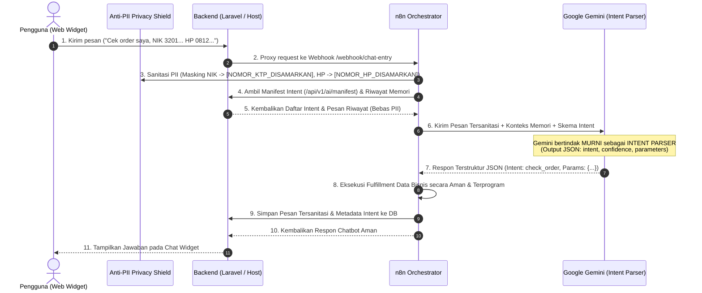

# 📘 MANUAL INTEGRASI & PANDUAN PENGEMBANGAN UNIVERSAL CHATBOT

Panduan lengkap arsitektur, integrasi, keamanan data sensitif (Anti-PII), serta AI Intent Parser dengan Multi-Turn Conversation Memory.

---

## 🧠 1. Konsep Arsitektur: AI Intent Parser & Privacy Shield

Sistem ini dirancang dengan prinsip **Zero Trust Privacy**:
1. **AI Agent Hanya Bertugas sebagai INTENT PARSER**: AI tidak memiliki akses langsung untuk menelusuri database ataupun mengeksekusi query data pribadi pengguna secara liar. AI murni mengklasifikasikan maksud (*intent*), mengekstrak slot/parameter yang relevan, serta memanfaatkan **Riwayat Memori Percakapan (*Multi-Turn Memory*)** untuk menjaga kontinuitas konteks.
2. **Anti-PII Privacy Shield (Data Masking Otomatis)**: Segala data pribadi pengguna yang sensitif seperti **Nomor KTP / NIK, Nomor HP, Email, Nomor Kartu Kredit, PIN, dan Password** otomatis disaring (*redacted*) menggunakan regex tokenisasi sebelum sampai ke model AI (Google Gemini) maupun sebelum disimpan ke database riwayat memori.
3. **Safe Programmatic Fulfillment**: Data bisnis atau hasil query diambil dan diformat secara terprogram di level sistem/orkestrator backend, bukan ditebak atau dihalusinasikan oleh LLM.



---

## 🛡️ 2. Mekanisme Keamanan: Anti-PII Protection Layer

Sistem menerapkan proteksi berlapis (*Defense-in-Depth*) agar AI tidak dapat membaca data sensitif:

| Jenis Data Sensitif | Pola Deteksi | Hasil Masking |
| :--- | :--- | :--- |
| **KTP / NIK** | 16 digit angka Indonesia (misal `3201...` atau `3171-....`) | `[NOMOR_KTP_DISAMARKAN]` |
| **Nomor HP / Telepon** | Format Indonesia `+628...`, `628...`, `08xx...` | `[NOMOR_HP_DISAMARKAN]` |
| **Email** | Alamat email `user@domain.com` | `[EMAIL_DISAMARKAN]` |
| **Kartu Kredit / Debit** | 13 s/d 19 digit angka kartu | `[KARTU_KREDIT_DISAMARKAN]` |
| **PIN, Password, OTP** | Kata kunci rahasia (`pin: 1234`, `password: ...`) | `[PIN/PASSWORD_DISAMARKAN]` |

### Tempat Penerapan Sanitasi:
1. **Frontend Widget (`package-frontend/chat-widget.js`)**: Memiliki filter awal sebelum pengiriman.
2. **Orkestrator n8n (`Normalize Input` & `Build Gemini Prompt`)**: Memfilter seluruh pesan masuk serta seluruh pesan riwayat memori sebelum prompt Gemini disusun.
3. **Backend Laravel (`app/Services/PiiSanitizer.php`)**: Memastikan endpoint penyimpanan `/api/v1/conversations/{id}/messages` dan pembacaan memori bebas dari PII.

---

## 🎯 3. AI Agent Sebagai Intent Parser dengan Memory

### Kenapa Intent Parser?
- AI tidak memegang kunci database secara langsung.
- AI menghasilkan format JSON yang terukur:
```json
{
  "intent": "get_monthly_revenue",
  "confidence": 0.98,
  "parameters": {
    "month": "Apr"
  },
  "requires_action": true,
  "matched_action": "get_monthly_revenue",
  "context_note": "Pengguna menanyakan performa revenue untuk bulan April",
  "reply": "Berikut rincian performa revenue untuk bulan April..."
}
```

### Bagaimana Memory Membantu?
Dengan memori multi-turn yang bersih dari PII:
- **Turn 1**: Pengguna: *"Tolong tampilkan performa revenue toko."* -> Intent: `get_store_metrics`.
- **Turn 2**: Pengguna: *"Kalau bulan april saja bagaimana?"* -> Dengan memori, AI memahami bahwa maksud pengguna adalah beralih ke rincian bulanan untuk bulan April (`get_monthly_revenue`, `month: "Apr"`).
- **Turn 3**: Pengguna: *"Bulan depannya lagi?"* -> AI menganalisis memori percakapan dan menyimpulkan bulan setelah April adalah Mei (`month: "May"`).

---

## 🛠️ 4. Cara Otomatis: Registrasi API Baru via Script

Gunakan script universal **`register-ai-capability.sh`** untuk mendaftarkan endpoint baru ke manifest:

### A. Memberikan Link URL Endpoint Langsung (`--url`)
```bash
./register-ai-capability.sh --url="http://localhost:8088/api/v1/store/metrics"
```

### B. Auto-Scan Semua Routes Project (`--scan`)
```bash
./register-ai-capability.sh --scan
```

### C. Impor dari File / URL Swagger OpenAPI Spec (`--spec`)
```bash
./register-ai-capability.sh --spec="./swagger.json"
```

### D. Mode Interaktif di Terminal
```bash
./register-ai-capability.sh
```

---

## 📝 5. Cara Manual Mendaftarkan API Baru

### Langkah 1: Buat Endpoint Data di Backend (`routes/api.php`)
```php
Route::middleware([VerifyInternalApiKey::class])->prefix('v1')->group(function () {
    Route::get('/store/revenue/monthly', function () {
        return response()->json([
            'status' => 'success',
            'data' => [
                'Jan' => ['orders' => 34, 'earnings' => '$89.25k', 'refunds' => 8],
                'Apr' => ['orders' => 68, 'earnings' => '$108.87k', 'refunds' => 17],
            ]
        ]);
    });
});
```

### Langkah 2: Daftarkan ke Manifest (`config/ai_registry.php`)
```php
return [
    'endpoints' => [
        [
            'action' => 'get_monthly_revenue',
            'method' => 'GET',
            'path' => '/api/v1/store/revenue/monthly',
            'description' => 'Melihat rincian performa revenue bulanan',
            'params' => ['month', 'year'],
            'current_data' => [
                'Apr' => ['orders' => 68, 'earnings' => '$108.87k', 'refunds' => 17],
            ]
        ],
    ],
];
```

---

## ⚡ 6. Menjalankan Laravel Natively (Pencegahan Deadlock)

Jika menjalankan Laravel via `php artisan serve`, gunakan multi-worker:

```bash
PHP_CLI_SERVER_WORKERS=4 php artisan serve --host=0.0.0.0 --port=8088 --no-reload
```

---

## 🐳 7. Setup & Import Orkestrator n8n

1. Sesuaikan variabel `.env`:
```env
GEMINI_API_KEY=AIzaSy...
BACKEND_BASE_URL=http://127.0.0.1:8088
INTERNAL_API_KEY=your_secure_internal_api_key_here
```

2. Jalankan container:
```bash
docker compose up -d
```

3. Import & publish workflow:
```bash
docker exec universal_chatbot_n8n n8n import:workflow --input=/backup/n8n/universal-chatbot-workflow.json
docker exec universal_chatbot_n8n n8n publish:workflow --id=universal-chatbot
docker restart universal_chatbot_n8n
```

---

## 💻 8. Integrasi Frontend Widget

Sematkan widget pada layout web Anda:

```html
<!-- Universal AI Chatbot Widget -->
<script 
    src="/chat-widget.js" 
    data-webhook="/api/webhook/chat-entry" 
    data-user-id="cust-8821">
</script>
```

Widget secara otomatis:
- Menampilkan badge privasi: `🛡️ Privasi Aman (Anti-PII)`.
- Menyaring data sensitif sebelum dikirim ke jaringan.
- Menampilkan tag intent yang terdeteksi secara elegan.
