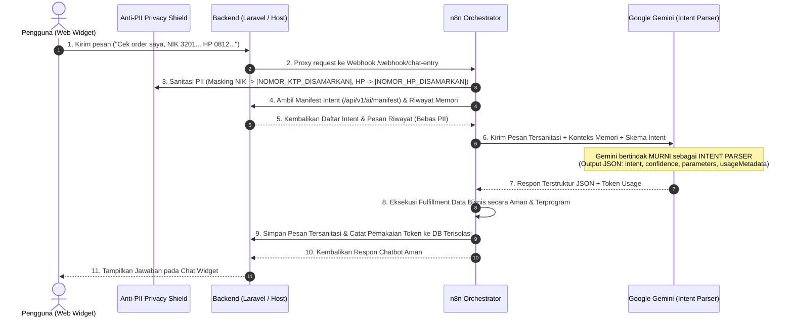
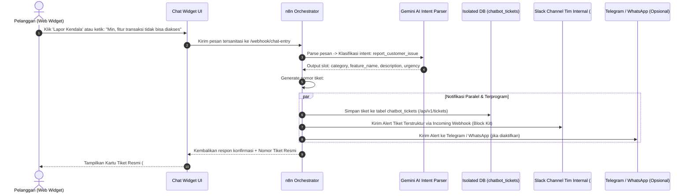
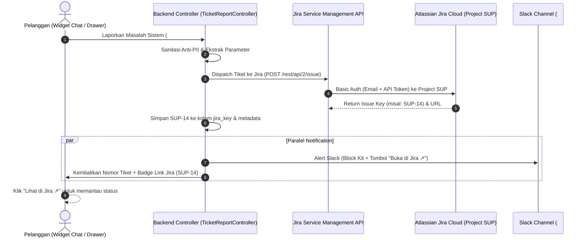
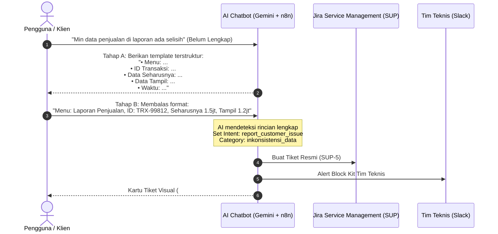

# 📘 MANUAL INTEGRASI & PANDUAN PENGEMBANGAN UNIVERSAL CHATBOT

Panduan lengkap arsitektur, integrasi non-intrusif (Zero Disruption ke Production), keamanan data sensitif (Anti-PII), isolasi database, pemantauan sisa token terpisah, serta AI Intent Parser dengan Multi-Turn Conversation Memory.

---

## 🧠 1. Konsep Arsitektur: AI Intent Parser & Privacy Shield

Sistem ini dirancang dengan prinsip **Zero Trust Privacy**:
1. **AI Agent Hanya Bertugas sebagai INTENT PARSER**: AI tidak memiliki akses langsung untuk menelusuri database ataupun mengeksekusi query data pribadi pengguna secara liar. AI murni mengklasifikasikan maksud (*intent*), mengekstrak slot/parameter yang relevan, serta memanfaatkan **Riwayat Memori Percakapan (*Multi-Turn Memory*)** untuk menjaga kontinuitas konteks.
2. **Anti-PII Privacy Shield (Data Masking Otomatis)**: Segala data pribadi pengguna yang sensitif seperti **Nomor KTP / NIK, Nomor HP, Email, Nomor Kartu Kredit, PIN, dan Password** otomatis disaring (*redacted*) menggunakan regex tokenisasi sebelum sampai ke model AI (Google Gemini) maupun sebelum disimpan ke database riwayat memori.
3. **Safe Programmatic Fulfillment**: Data bisnis atau hasil query diambil dan diformat secara terprogram di level sistem/orkestrator backend, bukan ditebak atau dihalusinasikan oleh LLM.



---

## 🛡️ 2. Mekanisme Keamanan: Anti-PII Protection Layer

Sistem menerapkan proteksi berlapis (*Defense-in-Depth*) agar AI tidak dapat membaca data sensitif:

| Jenis Data Sensitif | Pola Deteksi | Hasil Masking |
| :--- | :--- | :--- |
| **KTP / NIK** | 16 digit angka Indonesia (misal `3201...` atau `3171-....`) | `[NOMOR_KTP_DISAMARKAN]` |
| **Nomor HP / Telepon** | Format Indonesia `+628...`, `628...`, `08xx...` | `[NOMOR_HP_DISAMARKAN]` |
| **Email** | Alamat email `user@domain.com` | `[EMAIL_DISAMARKAN]` |
| **Kartu Kredit / Debit** | 13 s/d 19 digit angka kartu | `[KARTU_KREDIT_DISAMARKAN]` |
| **PIN, Password, OTP** | Kata kunci rahasia (`pin: 1234`, `password: ...`) | `[PIN/PASSWORD_DISAMARKAN]` |

### Tempat Penerapan Sanitasi:
1. **Frontend Widget (`package-frontend/chat-widget.js`)**: Memiliki filter awal sebelum pengiriman.
2. **Orkestrator n8n (`Normalize Input` & `Build Gemini Prompt`)**: Memfilter seluruh pesan masuk serta seluruh pesan riwayat memori sebelum prompt Gemini disusun.
3. **Backend Laravel (`app/Services/PiiSanitizer.php`)**: Memastikan endpoint penyimpanan `/api/v1/conversations/{id}/messages` dan pembacaan memori bebas dari PII.

---

## 🔒 3. Jaminan Zero-Disruption Database Produksi

Untuk menjamin integrasi chatbot **100% TIDAK MENGGANGGU** tabel dan transaksi database aplikasi produksi Anda:

### Pilihan A (Direkomendasikan): Isolasi Total Menggunakan SQLite Mandiri
Dengan konfigurasi ini, database production (MySQL/PostgreSQL) Anda **sama sekali tidak tersentuh** oleh chatbot.
1. Tambahkan koneksi baru di file `config/database.php` aplikasi Anda:
```php
'chatbot_sqlite' => [
    'driver' => 'sqlite',
    'database' => database_path('chatbot.sqlite'),
    'prefix' => '',
    'foreign_key_constraints' => false,
],
```
2. Buat file SQLite kosong:
```bash
touch database/chatbot.sqlite
```
3. Set variabel di `.env`:
```env
DB_CHATBOT_CONNECTION=chatbot_sqlite
```
4. Jalankan migrasi khusus:
```bash
php artisan migrate --database=chatbot_sqlite
```
*Hasil: Seluruh log pesan dan token disimpan di `database/chatbot.sqlite`. Database transaksi utama bisnis Anda bebas dari beban baca/tulis chat!*

### Pilihan B: Menggunakan Database yang Sama dengan Isolasi Tabel
Jika Anda memilih tetap menggunakan database MySQL/Postgres utama:
- Semua tabel chatbot menggunakan prefix terisolasi: `chatbot_conversation_messages` dan `chatbot_token_usages`.
- Migrasi dilengkapi pengecekan `if (!Schema::hasTable(...))`.
- **Tidak ada Foreign Key** ke tabel aplikasi produksi (`users`, `orders`, dll) sehingga proses query atau penghapusan data bisnis tidak akan pernah terblokir oleh tabel chatbot.
- Jika terjadi rollback, migrasi hanya menyentuh tabel chatbot tanpa mempengaruhi tabel lain.

---

## 🪙 4. Fitur Pemantauan Sisa Token & Pemakaian (TERPISAH)

Fitur pengecekan token sengaja dirancang **terpisah secara modular** agar:
- Tidak menambah latensi ataupun membebani widget percakapan pengguna akhir (*end-user*).
- Informasi kuota dan biaya Gemini API tidak bocor ke publik.
- Menggunakan skema *Fail-Safe*: Jika database pemantau token mengalami kendala, percakapan pengguna tetap berjalan normal tanpa terputus.

### 4 Cara Mengecek Token:

#### A. Melalui Web Dashboard Terpisah (`package-frontend/token-dashboard.html`)
Buka file `token-dashboard.html` di browser Anda:
- Kartu **Estimasi Sisa Kuota Token** (dengan indikator status: 🟢 Aman, 🟡 Waspada, 🔴 Habis).
- Kartu **Total Token Terpakai** (Bulan ini, Hari ini, dan All-Time).
- Baris **Progress Bar Kuota** real-time.
- **Live Token Calculator**: Masukkan teks kalimat/prompt apa saja untuk mengetahui perkiraan token yang terpakai sebelum dikirim ke AI.
- Tabel log riwayat pemanggilan per percakapan (Prompt vs Completion tokens).

#### B. Melalui Script Terminal / Bash
Jalankan script mandiri dari root folder:
```bash
./check-tokens.sh
```
Output terminal berformat rapi dengan warna:
```text
======================================================================
     GEMINI AI TOKEN USAGE & REMAINING QUOTA CHECKER (TERPISAH)       
======================================================================
🤖 Model AI       : gemini-2.5-flash
🎯 Status Kuota   : Aman (Normal) (12.4% terpakai)
----------------------------------------------------------------------
💰 Batas Kuota Bulanan       : 1,000,000 token
📈 Total Terpakai Bulan Ini  : 124,500 token
⏳ Estimasi SISA TOKEN       : 875,500 token
----------------------------------------------------------------------
📅 Pemakaian Hari Ini        : 14,200 token (28 requests)
🌐 Pemakaian Total All-Time  : 342,100 token (680 requests)
----------------------------------------------------------------------
✓ Pengecekan token selesai tanpa mengganggu sistem produksi.
```

#### C. Melalui Artisan Command (Laravel CLI)
```bash
# Tampilkan ringkasan sisa token
php artisan chatbot:tokens

# Tampilkan dengan 10 riwayat transaksi percakapan terakhir
php artisan chatbot:tokens --history

# Cek estimasi token untuk teks tertentu
php artisan chatbot:tokens --check="Halo, saya mau cek status transaksi order saya"
```

#### D. Melalui REST API Endpoint (Internal & Terproteksi)
Semua endpoint berada di bawah middleware `VerifyInternalApiKey`:
- `GET /api/v1/ai/tokens/summary`: Mengambil ringkasan sisa kuota, terpakai bulan ini/hari ini, status peringatan, dan limit Gemini.
- `GET /api/v1/ai/tokens/history?limit=20`: Mengambil log detail transaksi token per percakapan.
- `POST /api/v1/ai/tokens/count`: Menghitung token teks via API langsung (Body: `{"text": "..."}`).
- `POST /api/v1/ai/tokens/record`: Merekam transaksi token dari orkestrator (Body: `{"prompt_tokens": 120, "completion_tokens": 45, ...}`).
- `GET /api/v1/ai/tokens/keys`: Memeriksa jumlah dan daftar key tersamarkan di dalam Key Pool.

---

## 🔑 5. Gemini API Key Pool & Rotasi Otomatis (Anti-Kehabisan Kuota & Rate Limit)

Untuk menghindari kendala **kehabisan kuota atau terkena limit rate (HTTP 429 Resource Exhausted)**, sistem menyediakan fitur **Key Pool & Automatic Rotation**:

### Batasan Free Tier Gemini 2.5 Flash / 1.5 Flash per Akun:
- **15 RPM** (Requests Per Minute)
- **1,000,000 TPM** (Tokens Per Minute)
- **1,500 RPD** (Requests Per Day)

### Cara Kerja Rotasi & Failover:
1. **Round-Robin Load Balancing**:
   Setiap pesan percakapan baru didistribusikan secara dinamis bergilir ke kumpulan API key yang terdaftar di `.env`. Ini mencegah satu key menerima lonjakan traffic mendadak.
2. **Automatic Failover pada Error 429**:
   Jika salah satu API key mencapai limit harian (*quota exhausted*) atau terkena *rate limit*, orkestrator n8n dan backend otomatis mencoba (*retry*) menggunakan key cadangan berikutnya di dalam pool secara instan. Pengguna akhir **tidak akan merasakan error**.
3. **Kapasitas Terakumulasi**:
   - 1 Key = 15 RPM, 1.500 requests/hari, ~1.000.000 token/bulan
   - 3 Keys = 45 RPM, 4.500 requests/hari, ~3.000.000 token/bulan
   - 5 Keys = 75 RPM, 7.500 requests/hari, ~5.000.000 token/bulan

### Cara Mengaktifkan Multi-Key:
Di file `.env`, cukup cantumkan beberapa API key yang dipisahkan koma atau spasi:
```env
# Multi-Key Pool (Bisa 2, 3, 5, atau lebih)
GEMINI_API_KEYS=AIzaSyA11111111,AIzaSyB22222222,AIzaSyC33333333
```
*Catatan: Variabel tunggal `GEMINI_API_KEY` tetap didukung untuk backward compatibility.*

---

## 🐳 6. Kompatibilitas Lingkungan: Docker vs Native

Chatbot ini dirancang untuk bekerja secara mulus pada lingkungan **Docker** maupun **Native**:

### Matriks Integrasi:

| Lingkungan Aplikasi Host | Cara Menjalankan n8n | Konfigurasi `BACKEND_BASE_URL` di n8n | Keterangan |
| :--- | :--- | :--- | :--- |
| **Native (Host OS)**<br>Nginx, Apache, PHP-FPM, Artisan | Docker Compose | `http://host.docker.internal:8000` | `docker-compose.yml` telah dilengkapi `host.docker.internal:host-gateway` |
| **Dockerized App**<br>Aplikasi sudah berjalan di Docker | Docker Compose | `http://<nama_service_app>:8000` | Masukkan n8n ke network docker yang sama dengan aplikasi Anda |
| **Native Murni (Tanpa Docker)** | `npm install -g n8n` / PM2 | `http://127.0.0.1:8000` | Jalankan n8n secara lokal via nodejs tanpa container |

### Pencegahan Konflik Port:
Jika port `5678` sudah dipakai oleh aplikasi lain di server, ubah port di `.env`:
```env
N8N_PORT=5688
```
Kemudian jalankan:
```bash
docker compose up -d
```

### Circuit Breaker & Fail-Safe Proxy:
File `routes/chatbot.php` menyediakan route proxy `/webhook/chat-entry` dengan timeout bawaan (30 detik). Jika n8n atau koneksi internet ke Gemini terputus:
- Host aplikasi **TIDAK AKAN CRASH** dan **TIDAK MENGELUARKAN 500 ERROR**.
- Mengembalikan respon HTTP 503 dengan pesan ramah pemeliharaan otomatis kepada pengguna.

---

## 🛠️ 6. Cara Otomatis: Registrasi API Baru via Script

Gunakan script universal **`register-ai-capability.sh`** untuk mendaftarkan endpoint baru ke manifest:

### A. Memberikan Link URL Endpoint Langsung (`--url`)
```bash
./register-ai-capability.sh --url="http://localhost:8088/api/v1/store/metrics"
```

### B. Auto-Scan Semua Routes Project (`--scan`)
```bash
./register-ai-capability.sh --scan
```

### C. Impor dari File / URL Swagger OpenAPI Spec (`--spec`)
```bash
./register-ai-capability.sh --spec="./swagger.json"
```

### D. Mode Interaktif di Terminal
```bash
./register-ai-capability.sh
```

---

## 📝 7. Cara Menghubungkan Backend Laravel (Cukup 1 Baris)

Agar file `routes/api.php` aplikasi produksi Anda tetap bersih dan tidak berantakan:
1. Salin `package-backend/routes/chatbot.php` ke folder `routes/` aplikasi Anda.
2. Di file `routes/api.php` Anda, cukup tambahkan 1 baris:
```php
require __DIR__ . '/chatbot.php';
```

---

## ⚡ 8. Menjalankan Laravel Natively (Pencegahan Deadlock)

Jika menjalankan Laravel via `php artisan serve` saat tahap pengujian lokal:
```bash
PHP_CLI_SERVER_WORKERS=4 php artisan serve --host=0.0.0.0 --port=8088 --no-reload
```

---

## 💻 9. Integrasi Frontend Widget
 
Sematkan widget pada layout web Anda (`app.blade.php` atau `index.html`):

```html
<!-- Universal AI Chatbot Widget -->
<script 
    src="/chat-widget.js" 
    data-webhook="/api/webhook/chat-entry" 
    data-user-id="cust-8821"
    data-user-name="Budi Pratama"
    data-bot-name="Asisten Virtual">
</script>
```

Widget secara otomatis:
- Menyapa pengguna dengan nama personalnya saat pertama kali chat dibuka.
- Menampilkan chip shortcut bantuan cepat (*Quick Actions*).
- Menyediakan formulir lapor kendala langsung (*Issue Drawer*) dan pengenalan otomatis keluhan dari chat.
- Menampilkan badge privasi: `🛡️ Privasi Aman (Anti-PII)`.
- Menyaring data sensitif sebelum dikirim ke jaringan.
- Menampilkan tag intent & kartu tiket resmi (#TCK-...) yang terdeteksi.

---

## 👋 10. Fitur Sapaan Awal Personal (Personalized Greeting)

Ketika pengguna membuka bubble chat pertama kali, widget secara otomatis menyapa pengguna secara ramah dan profesional:
- **Atribut yang didukung:**
  - `data-user-name="Budi Pratama"`: Nama lengkap / panggilan pengguna.
  - `data-user-id="USER-123"`: ID akun pengguna.
  - `data-bot-name="Customer Support AI"`: Nama identitas asisten virtual.
  - `data-greeting="Halo Kak Budi! Ada yang bisa kami bantu?"`: Teks kustom jika ingin override salam pembuka.
- **Tampilan Sapaan:**
  > *"Halo **Budi Pratama**! 👋 Ada yang bisa kami bantu hari ini? Silakan pilih bantuan cepat di bawah atau tanyakan apapun mengenai data toko Anda:"*
- **Tombol Pintas (Quick Action Chips):**
  - 📊 `Metrik Toko`: Menampilkan total earnings, orders, customers, balance.
  - 📈 `Laporan Revenue`: Menampilkan rincian pendapatan bulanan.
  - 🚨 `Lapor Kendala Fitur`: Membuka formulir lapor kendala langsung ke tim teknis.

---

## 🚨 11. Fitur Laporan Kendala Pelanggan & Tiket Tim Internal (Slack / Telegram / WhatsApp)

Fitur ini memungkinkan pelanggan melaporkan masalah sistem (misalnya: **fitur tidak dapat diakses**, **tombol error 500**, **halaman checkout gagal**, atau **kendala transaksi**) baik melalui percakapan chat maupun formulir kendala (*Issue Drawer*).

> 💡 **Rekomendasi Utama: Channel Slack**  
> Slack sangat direkomendasikan dibandingkan aplikasi chat biasa karena memiliki **tampilan yang jauh lebih tertata (Slack Block Kit)**, mendukung pewarnaan urgensi (*Color Sidebar*), dan setiap tiket dapat langsung **didiskusikan di dalam thread** tanpa membuat channel berantakan.

### 🔄 Alur Kerja Pelaporan & Tiket:


### ⚙️ Konfigurasi Notifikasi di `.env`:

#### 1. Setup Notifikasi Slack (Sangat Direkomendasikan):
1. Buka [Slack API Apps](https://api.slack.com/apps) lalu klik **Create New App** ➔ **From scratch**.
2. Beri nama aplikasi (misal: `Incident Bot`) dan pilih Workspace Slack tim Anda.
3. Di bilah menu kiri, pilih **Incoming Webhooks**, lalu ubah toggle menjadi **On**.
4. Klik tombol **Add New Webhook to Workspace** di bagian bawah, pilih channel tujuan (misal: `#customer-tickets` atau `#dev-alerts`), lalu klik **Allow**.
5. Salin **Webhook URL** yang dihasilkan (`https://hooks.slack.com/services/T.../B.../...`).
6. Masukkan ke file `.env`:
```env
SLACK_NOTIFICATIONS_ENABLED=true
SLACK_WEBHOOK_URL=https://hooks.slack.com/services/YOUR_WORKSPACE_ID/YOUR_BOT_ID/YOUR_WEBHOOK_TOKEN
SLACK_CHANNEL=#customer-tickets
```

#### 2. Setup Notifikasi Telegram (Opsional):
Jika Anda tetap ingin menyalakan alert ke Telegram selain/tanpa Slack:
```env
TELEGRAM_NOTIFICATIONS_ENABLED=true
TELEGRAM_BOT_TOKEN=123456789:ABCdefGhIJKlmNoPQRsTUVwxyZ
TELEGRAM_CHAT_ID=-1001234567890
```

#### 3. Setup Notifikasi WhatsApp (Opsional):
Jika menggunakan gateway WhatsApp (Wablas, Fonnte, Twilio, atau custom webhook):
```env
WHATSAPP_NOTIFICATIONS_ENABLED=true
WHATSAPP_API_URL=https://api.fonnte.com/send
WHATSAPP_API_KEY=your_fonnte_token_here
WHATSAPP_TARGET_NUMBER=08123456789
```

---

### 📋 Tampilan Pesan Alert di Channel Slack (Block Kit):

Di Slack, pesan akan muncul dalam kartu terstruktur dengan garis samping berwarna sesuai tingkat urgensi:

```text
┌─────────────────────────────────────────────────────────────────────────────┐
│ 🚨 Tiket Gangguan Baru dari Pelanggan                                       │
│                                                                             │
│ 🎫 No. Tiket:             👤 Pelapor:                                       │
│ #TCK-20261022-8F2A        USER-BUDI-123 (Budi Pratama)                      │
│                                                                             │
│ 📋 Kategori:              🛠 Fitur Terkendala:                              │
│ Fitur Tidak Dapat Diakses  Riwayat Transaksi                                 │
│                                                                             │
│ ⚡ Urgensi:                🕒 Waktu Laporan:                                 │
│ TINGGI                    2026-10-22 13:45:00 WIB                           │
│                                                                             │
│ 📝 Detail Kendala:                                                          │
│ > Pengguna mengeluhkan tombol transaksi error dan halaman gagal dimuat.     │
│                                                                             │
│ 💬 ID Percakapan: conv-5gj873h | Status: OPEN | Tindak lanjuti pada thread  │
└─────────────────────────────────────────────────────────────────────────────┘
```
*(Warna border: Merah untuk Darurat, Oranye untuk Tinggi, Kuning untuk Sedang, Biru untuk Rendah)*

---

### 🗄️ Tabel Database Terisolasi: `chatbot_tickets`
Tabel ini dibuat melalui migrasi `2025_01_01_000002_create_chatbot_tickets_table.php` & `2025_01_01_000003_add_jira_fields_to_chatbot_tickets_table.php`:
- `ticket_number`: Nomor unik tiket (misal: `TCK-20261022-8F2A`)
- `conversation_id`: Referensi sesi percakapan
- `user_id`: ID pengguna pelapor
- `user_name`: Nama pengguna
- `category`: Kategori masalah (`fitur_tidak_dapat_diakses`, `bug_error`, `transaksi`, dll.)
- `feature_name`: Nama fitur yang terkendala
- `description`: Detail masalah (bebas dari PII)
- `urgency`: `rendah`, `sedang`, `tinggi`, `darurat`
- `status`: `open`, `investigating`, `resolved`, `closed`
- `channel`: Kanal pelaporan (`web`, `drawer`, `mobile`)
- `jira_key`: Nomor Issue resmi Jira (misal: `SUP-12`)
- `jira_url`: Link langsung ke tiket Jira (misal: `https://imtekservice.atlassian.net/browse/SUP-12`)
- `notified_channels`: Rekam jejak status pengiriman notifikasi `{"slack": true, "telegram": false, "whatsapp": false}`
- `metadata`: JSON metadata lengkap termasuk respon data Jira Service Management

### 🔌 Endpoint REST API Tiket Internal (Protected):
- `POST /api/v1/tickets`: Menerbitkan tiket baru, membuat issue di Jira Service Desk (SUP), dan memicu notifikasi Slack/Telegram/WhatsApp.
- `GET /api/v1/tickets`: Menampilkan daftar tiket (filter: `status`, `user_id`, `category`).
- `GET /api/v1/tickets/{ticketNumber}`: Mengambil detail tiket (termasuk `jira_key` & `jira_url`).
- `PATCH /api/v1/tickets/{ticketNumber}/status`: Memperbarui status penanganan tiket (`open` ➔ `investigating` ➔ `resolved`).
- `POST/GET /api/v1/tickets/{ticketNumber}/jira-sync`: Melakukan sinkronisasi status tiket dari Jira Cloud ke database lokal.
- `POST/GET /api/v1/jira/test-connection`: Menguji status kredensial dan hak akses proyek Jira Service Desk.

---

## 🌐 12. Panduan Integrasi Jira Service Management (Proyek SUP - Atlassian)

Universal Chatbot kini terintegrasi penuh secara bidirectional dengan **Jira Service Management / Jira Service Desk**:
- **Jira Cloud Instance:** `https://imtekservice.atlassian.net`
- **Project Key:** `SUP`
- **Dashboard Proyek:** [https://imtekservice.atlassian.net/jira/servicedesk/projects/SUP/getting-started](https://imtekservice.atlassian.net/jira/servicedesk/projects/SUP/getting-started)



### ⚙️ Langkah Setup & Kredensial Jira:

#### 1. Dapatkan Atlassian API Token (Gratis):
1. Buka halaman manajemen keamanan Atlassian:  
   👉 [https://id.atlassian.com/manage-profile/security/api-tokens](https://id.atlassian.com/manage-profile/security/api-tokens)
2. Klik tombol **Create API token**.
3. Beri label (misalnya: `Universal Chatbot`).
4. Salin token API yang ditampilkan (token hanya muncul satu kali).

#### 2. Konfigurasi Variabel di `.env`:
Tambahkan atau sesuaikan baris berikut pada file `.env`:
```env
# Integrasi Jira Service Management / Jira Service Desk (Atlassian)
JIRA_ENABLED=true
JIRA_HOST=imtekservice.atlassian.net
JIRA_PROJECT_KEY=SUP
JIRA_USER_EMAIL=email_atlassian_anda@domain.com
JIRA_API_TOKEN=ATATT3xFfGF0...your_token_here...
JIRA_ISSUE_TYPE=Service Request
```

> [!TIP]
> Nilai `JIRA_USER_EMAIL` adalah email yang Anda gunakan untuk login ke [https://imtekservice.atlassian.net](https://imtekservice.atlassian.net).  
> Nilai `JIRA_PROJECT_KEY` telah disetel ke `SUP`.

#### 3. Uji Koneksi & Diagnostik:
Gunakan script diagnostik mandiri untuk memverifikasi kredensial:
```bash
# Cek autentikasi dan ketersediaan Project SUP:
./check-jira.sh

# Cek sekaligus membuat tiket uji coba di Jira Service Desk:
./check-jira.sh --create-issue
```

Atau menggunakan perintah Artisan Laravel:
```bash
php artisan chatbot:jira --test
php artisan chatbot:jira --create-test-issue
```

#### 4. Fitur-Fitur Jira yang Didukung:
- **Auto Issue Creation**: Pembuatan otomatis issue/ticket di Jira Service Desk saat customer mengeluh di chat / form drawer.
- **Urgency Mapping**:
  - `darurat` / `critical` ➔ Priority: `Highest`
  - `tinggi` / `high` ➔ Priority: `High`
  - `sedang` / `medium` ➔ Priority: `Medium`
  - `rendah` / `low` ➔ Priority: `Low`
- **Intelligent Issue Type Fallback**: Jika tipe issue yang disetel di `.env` tidak ada pada skema project SUP, sistem otomatis mendeteksi issue type valid yang tersedia dan membuat tiket tanpa throw error.
- **Clickable Badge in Chat Widget**: Pelanggan mendapatkan kartu tiket interaktif dengan tombol langsung `🌐 Jira Service Desk: SUP-XX ↗`.
- **Block Kit Integration in Slack**: Alert Slack menyertakan link tiket Jira dan tombol action *Buka di Jira ↗*.
- **Sync Status Endpoint**: Status penyelesaian issue di Jira dapat disinkronkan kembali ke database lokal melalui endpoint `POST /api/v1/tickets/{ticketNumber}/jira-sync`.

---

## 📚 13. Panduan Automasi SOP Pertanyaan Non-Teknis & Formulir Verifikasi Data (Solusi Masalah Berulang PM / Konsultan)

### 13.1. Mengapa Ini Krusial bagi Project Management & Konsultan TI?
Dalam delivery proyek aplikasi, PM dan konsultan sering terjebak dalam **3 masalah berulang**:
1. **Deflection Rate Rendah / FAQ Fatigue:** Tim developer kehabisan sprint capacity karena sering diganggu pertanyaan operasional berulang (tidak bisa login, export loading lama, pembayaran belum masuk).
2. **Chat Ping-Pong Tanpa Akhir:** Klien hanya melapor *"Datanya salah mas!"* tanpa detail. Konsultan harus bolak-balik bertanya seharian hanya untuk mencari tahu ID transaksi dan menu mana yang bermasalah.
3. **Shadow Support:** Keluhan klien masuk via chat informal personal, tidak tercatat di Jira, tidak ada SLA, dan audit trail hilang.

Sistem chatbot ini menyelesaikan ketiga masalah tersebut secara tuntas melalui **Automasi SOP Non-Teknis** dan **Guided Verification Form** yang terhubung langsung ke **Jira Service Desk (SUP)**.

---

### 13.2. Lima (5) SOP Standar yang Disediakan Out-of-the-Box

| Kategori Skenario | Trigger Kata Kunci | Respon Cerdas AI & Langkah Praktis | Alur Eskalasi Tiket |
| :--- | :--- | :--- | :--- |
| **🔑 Kendala Login & Akun** | *tidak bisa login, lupa password, akun terkunci, gagal masuk* | 1. Cek ejaan email & Caps Lock.<br>2. Arahkan ke fitur **Lupa Password?** untuk reset via email.<br>3. Sarankan bersihkan Cache atau mode Incognito.<br>4. Info proteksi lockout jika >5x gagal. | Tawarkan: *"Ketik 'Buatkan tiket kendala login' agar admin IT membuka blokir akun."* |
| **📋 Selisih / Inkonsistensi Data** | *data tidak sesuai, selisih, angka salah, laporan tidak cocok* | **Kasus A (Belum Lengkap):** AI langsung memberikan formulir terstruktur verifikasi data.<br>**Kasus B (Formulir Terisi):** AI otomatis mengonversinya menjadi tiket resmi Jira! | **Otomatis terbit di Jira (SUP)** kategori `inkonsistensi_data` dengan status `High Priority`. |
| **📑 File Laporan Gagal Export** | *tidak bisa export, download excel/pdf gagal, tombol export macet* | 1. Perkecil rentang filter tanggal (coba per bulan/minggu agar memori tidak timeout).<br>2. Rekomendasikan format alternatif **CSV** yang lebih ringan.<br>3. Periksa pop-up blocker browser.<br>4. Hindari klik tombol berulang kali saat status loading. | Jika tombol tetap tidak merespon/error 500, user dapat mengetik *"Buatkan tiket error export"* ke developer. |
| **💳 Status Pembayaran Pending** | *sudah transfer tapi pending, pembayaran belum masuk* | 1. Jelaskan SLA verifikasi otomatis VA/QRIS (1-5 menit).<br>2. Sarankan cek mutasi rekening bank / e-wallet.<br>3. Jika >15 menit status belum berubah, minta nomor invoice/transaksi. | AI langsung membuat tiket konfirmasi manual untuk tim finance. |
| **⚠️ Halaman Blank / Loading Lama** | *loading berputar, blank putih, error 500, web macet* | 1. Pandu **Hard Refresh** (`Ctrl + F5` atau `Cmd + Shift + R`).<br>2. Periksa kestabilan jaringan internet.<br>3. Uji melalui browser alternatif. | Jika error berlanjut, laporkan kode error untuk tiket investigasi infrastruktur/server. |

---

### 13.3. Mekanisme Two-Stage Handling pada Selisih Data



---

### 13.4. Cara Menyesuaikan / Menambah SOP di `config/ai_registry.php`

Konsultan TI dapat menambah atau memodifikasi SOP kapan saja di file `config/ai_registry.php`:

```php
'support_templates' => [
    'nama_skenario_baru' => [
        'topic'    => 'Judul Topik Panduan',
        'keywords' => ['kata_kunci_1', 'kata_kunci_2'],
        'steps'    => [
            'Langkah 1 yang jelas dan ramah...',
            'Langkah 2 alternatif solusi...',
        ],
        'escalation' => 'Pilihan tindakan pembuatan tiket jika solusi mandiri gagal.'
    ],
],
```
Endpoint `/api/v1/ai/manifest` akan otomatis menyajikan template ini ke n8n orchestrator tanpa perlu re-deploy aplikasi.

---

### 13.5. Auto-Detect User Session (2 Lapis Pengamanan)

Untuk menghindari tiket anonim yang membingungkan konsultan (*"Ini tiket dari akun siapa?"*), sistem menerapkan 2 lapis identifikasi otomatis:
1. **Lapis 1 (Client-side di `chat-widget.js`):** Membaca dataset Inertia.js `document.getElementById('app').dataset.page` ➔ mengekstrak `props.auth.user.name` & `props.auth.user.id`.
2. **Lapis 2 (Server-side di `app.blade.php`):**
   ```blade
   <script 
       src="/chat-widget.js" 
       data-webhook="http://127.0.0.1:5678/webhook/chat-entry" 
       data-user-name="{{ Auth::check() ? Auth::user()->name : '' }}" 
       data-user-id="{{ Auth::check() ? 'user-' . Auth::id() : 'guest' }}">
   </script>
   ```
3. **Quick Action Chips:** Widget menyajikan shortcut tombol cepat di tampilan awal:
   `🔑 Bantuan Login`, `📑 Gagal Export`, `📋 Selisih Data`, `📊 Metrik Toko`, `📈 Laporan Revenue`, dan `🚨 Lapor Kendala Fitur`.

