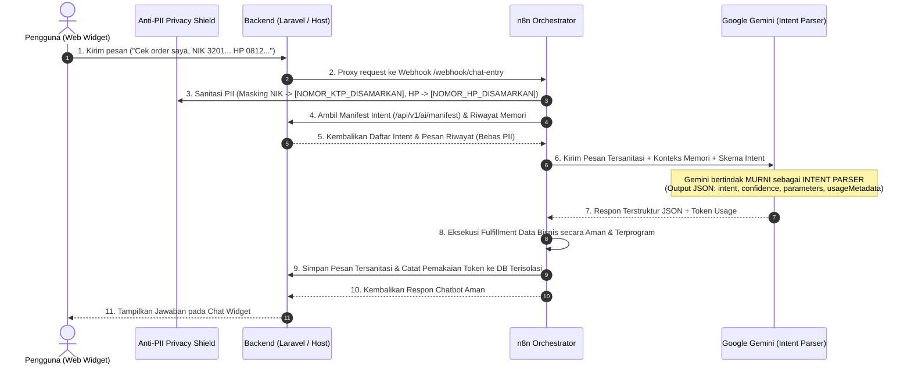

# 📘 MANUAL INTEGRASI & PANDUAN PENGEMBANGAN UNIVERSAL CHATBOT

Panduan lengkap arsitektur, integrasi non-intrusif (Zero Disruption ke Production), keamanan data sensitif (Anti-PII), isolasi database, pemantauan sisa token terpisah, serta AI Intent Parser dengan Multi-Turn Conversation Memory.

---

## 🧠 1. Konsep Arsitektur: AI Intent Parser & Privacy Shield

Sistem ini dirancang dengan prinsip **Zero Trust Privacy**:
1. **AI Agent Hanya Bertugas sebagai INTENT PARSER**: AI tidak memiliki akses langsung untuk menelusuri database ataupun mengeksekusi query data pribadi pengguna secara liar. AI murni mengklasifikasikan maksud (*intent*), mengekstrak slot/parameter yang relevan, serta memanfaatkan **Riwayat Memori Percakapan (*Multi-Turn Memory*)** untuk menjaga kontinuitas konteks.
2. **Anti-PII Privacy Shield (Data Masking Otomatis)**: Segala data pribadi pengguna yang sensitif seperti **Nomor KTP / NIK, Nomor HP, Email, Nomor Kartu Kredit, PIN, dan Password** otomatis disaring (*redacted*) menggunakan regex tokenisasi sebelum sampai ke model AI (Google Gemini) maupun sebelum disimpan ke database riwayat memori.
3. **Safe Programmatic Fulfillment**: Data bisnis atau hasil query diambil dan diformat secara terprogram di level sistem/orkestrator backend, bukan ditebak atau dihalusinasikan oleh LLM.



---

## 🛡️ 2. Mekanisme Keamanan: Anti-PII Protection Layer

Sistem menerapkan proteksi berlapis (*Defense-in-Depth*) agar AI tidak dapat membaca data sensitif:

| Jenis Data Sensitif | Pola Deteksi | Hasil Masking |
| :--- | :--- | :--- |
| **KTP / NIK** | 16 digit angka Indonesia (misal `3201...` atau `3171-....`) | `[NOMOR_KTP_DISAMARKAN]` |
| **Nomor HP / Telepon** | Format Indonesia `+628...`, `628...`, `08xx...` | `[NOMOR_HP_DISAMARKAN]` |
| **Email** | Alamat email `user@domain.com` | `[EMAIL_DISAMARKAN]` |
| **Kartu Kredit / Debit** | 13 s/d 19 digit angka kartu | `[KARTU_KREDIT_DISAMARKAN]` |
| **PIN, Password, OTP** | Kata kunci rahasia (`pin: 1234`, `password: ...`) | `[PIN/PASSWORD_DISAMARKAN]` |

### Tempat Penerapan Sanitasi:
1. **Frontend Widget (`package-frontend/chat-widget.js`)**: Memiliki filter awal sebelum pengiriman.
2. **Orkestrator n8n (`Normalize Input` & `Build Gemini Prompt`)**: Memfilter seluruh pesan masuk serta seluruh pesan riwayat memori sebelum prompt Gemini disusun.
3. **Backend Laravel (`app/Services/PiiSanitizer.php`)**: Memastikan endpoint penyimpanan `/api/v1/conversations/{id}/messages` dan pembacaan memori bebas dari PII.

---

## 🔒 3. Jaminan Zero-Disruption Database Produksi

Untuk menjamin integrasi chatbot **100% TIDAK MENGGANGGU** tabel dan transaksi database aplikasi produksi Anda:

### Pilihan A (Direkomendasikan): Isolasi Total Menggunakan SQLite Mandiri
Dengan konfigurasi ini, database production (MySQL/PostgreSQL) Anda **sama sekali tidak tersentuh** oleh chatbot.
1. Tambahkan koneksi baru di file `config/database.php` aplikasi Anda:
```php
'chatbot_sqlite' => [
    'driver' => 'sqlite',
    'database' => database_path('chatbot.sqlite'),
    'prefix' => '',
    'foreign_key_constraints' => false,
],
```
2. Buat file SQLite kosong:
```bash
touch database/chatbot.sqlite
```
3. Set variabel di `.env`:
```env
DB_CHATBOT_CONNECTION=chatbot_sqlite
```
4. Jalankan migrasi khusus:
```bash
php artisan migrate --database=chatbot_sqlite
```
*Hasil: Seluruh log pesan dan token disimpan di `database/chatbot.sqlite`. Database transaksi utama bisnis Anda bebas dari beban baca/tulis chat!*

### Pilihan B: Menggunakan Database yang Sama dengan Isolasi Tabel
Jika Anda memilih tetap menggunakan database MySQL/Postgres utama:
- Semua tabel chatbot menggunakan prefix terisolasi: `chatbot_conversation_messages` dan `chatbot_token_usages`.
- Migrasi dilengkapi pengecekan `if (!Schema::hasTable(...))`.
- **Tidak ada Foreign Key** ke tabel aplikasi produksi (`users`, `orders`, dll) sehingga proses query atau penghapusan data bisnis tidak akan pernah terblokir oleh tabel chatbot.
- Jika terjadi rollback, migrasi hanya menyentuh tabel chatbot tanpa mempengaruhi tabel lain.

---

## 🪙 4. Fitur Pemantauan Sisa Token & Pemakaian (TERPISAH)

Fitur pengecekan token sengaja dirancang **terpisah secara modular** agar:
- Tidak menambah latensi ataupun membebani widget percakapan pengguna akhir (*end-user*).
- Informasi kuota dan biaya Gemini API tidak bocor ke publik.
- Menggunakan skema *Fail-Safe*: Jika database pemantau token mengalami kendala, percakapan pengguna tetap berjalan normal tanpa terputus.

### 4 Cara Mengecek Token:

#### A. Melalui Web Dashboard Terpisah (`package-frontend/token-dashboard.html`)
Buka file `token-dashboard.html` di browser Anda:
- Kartu **Estimasi Sisa Kuota Token** (dengan indikator status: 🟢 Aman, 🟡 Waspada, 🔴 Habis).
- Kartu **Total Token Terpakai** (Bulan ini, Hari ini, dan All-Time).
- Baris **Progress Bar Kuota** real-time.
- **Live Token Calculator**: Masukkan teks kalimat/prompt apa saja untuk mengetahui perkiraan token yang terpakai sebelum dikirim ke AI.
- Tabel log riwayat pemanggilan per percakapan (Prompt vs Completion tokens).

#### B. Melalui Script Terminal / Bash
Jalankan script mandiri dari root folder:
```bash
./check-tokens.sh
```
Output terminal berformat rapi dengan warna:
```text
======================================================================
     GEMINI AI TOKEN USAGE & REMAINING QUOTA CHECKER (TERPISAH)       
======================================================================
🤖 Model AI       : gemini-2.5-flash
🎯 Status Kuota   : Aman (Normal) (12.4% terpakai)
----------------------------------------------------------------------
💰 Batas Kuota Bulanan       : 1,000,000 token
📈 Total Terpakai Bulan Ini  : 124,500 token
⏳ Estimasi SISA TOKEN       : 875,500 token
----------------------------------------------------------------------
📅 Pemakaian Hari Ini        : 14,200 token (28 requests)
🌐 Pemakaian Total All-Time  : 342,100 token (680 requests)
----------------------------------------------------------------------
✓ Pengecekan token selesai tanpa mengganggu sistem produksi.
```

#### C. Melalui Artisan Command (Laravel CLI)
```bash
# Tampilkan ringkasan sisa token
php artisan chatbot:tokens

# Tampilkan dengan 10 riwayat transaksi percakapan terakhir
php artisan chatbot:tokens --history

# Cek estimasi token untuk teks tertentu
php artisan chatbot:tokens --check="Halo, saya mau cek status transaksi order saya"
```

#### D. Melalui REST API Endpoint (Internal & Terproteksi)
Semua endpoint berada di bawah middleware `VerifyInternalApiKey`:
- `GET /api/v1/ai/tokens/summary`: Mengambil ringkasan sisa kuota, terpakai bulan ini/hari ini, status peringatan, dan limit Gemini.
- `GET /api/v1/ai/tokens/history?limit=20`: Mengambil log detail transaksi token per percakapan.
- `POST /api/v1/ai/tokens/count`: Menghitung token teks via API langsung (Body: `{"text": "..."}`).
- `POST /api/v1/ai/tokens/record`: Merekam transaksi token dari orkestrator (Body: `{"prompt_tokens": 120, "completion_tokens": 45, ...}`).
- `GET /api/v1/ai/tokens/keys`: Memeriksa jumlah dan daftar key tersamarkan di dalam Key Pool.

---

## 🔑 5. Gemini API Key Pool & Rotasi Otomatis (Anti-Kehabisan Kuota & Rate Limit)

Untuk menghindari kendala **kehabisan kuota atau terkena limit rate (HTTP 429 Resource Exhausted)**, sistem menyediakan fitur **Key Pool & Automatic Rotation**:

### Batasan Free Tier Gemini 2.5 Flash / 1.5 Flash per Akun:
- **15 RPM** (Requests Per Minute)
- **1,000,000 TPM** (Tokens Per Minute)
- **1,500 RPD** (Requests Per Day)

### Cara Kerja Rotasi & Failover:
1. **Round-Robin Load Balancing**:
   Setiap pesan percakapan baru didistribusikan secara dinamis bergilir ke kumpulan API key yang terdaftar di `.env`. Ini mencegah satu key menerima lonjakan traffic mendadak.
2. **Automatic Failover pada Error 429**:
   Jika salah satu API key mencapai limit harian (*quota exhausted*) atau terkena *rate limit*, orkestrator n8n dan backend otomatis mencoba (*retry*) menggunakan key cadangan berikutnya di dalam pool secara instan. Pengguna akhir **tidak akan merasakan error**.
3. **Kapasitas Terakumulasi**:
   - 1 Key = 15 RPM, 1.500 requests/hari, ~1.000.000 token/bulan
   - 3 Keys = 45 RPM, 4.500 requests/hari, ~3.000.000 token/bulan
   - 5 Keys = 75 RPM, 7.500 requests/hari, ~5.000.000 token/bulan

### Cara Mengaktifkan Multi-Key:
Di file `.env`, cukup cantumkan beberapa API key yang dipisahkan koma atau spasi:
```env
# Multi-Key Pool (Bisa 2, 3, 5, atau lebih)
GEMINI_API_KEYS=AIzaSyA11111111,AIzaSyB22222222,AIzaSyC33333333
```
*Catatan: Variabel tunggal `GEMINI_API_KEY` tetap didukung untuk backward compatibility.*

---

## 🐳 6. Kompatibilitas Lingkungan: Docker vs Native

Chatbot ini dirancang untuk bekerja secara mulus pada lingkungan **Docker** maupun **Native**:

### Matriks Integrasi:

| Lingkungan Aplikasi Host | Cara Menjalankan n8n | Konfigurasi `BACKEND_BASE_URL` di n8n | Keterangan |
| :--- | :--- | :--- | :--- |
| **Native (Host OS)**<br>Nginx, Apache, PHP-FPM, Artisan | Docker Compose | `http://host.docker.internal:8000` | `docker-compose.yml` telah dilengkapi `host.docker.internal:host-gateway` |
| **Dockerized App**<br>Aplikasi sudah berjalan di Docker | Docker Compose | `http://<nama_service_app>:8000` | Masukkan n8n ke network docker yang sama dengan aplikasi Anda |
| **Native Murni (Tanpa Docker)** | `npm install -g n8n` / PM2 | `http://127.0.0.1:8000` | Jalankan n8n secara lokal via nodejs tanpa container |

### Pencegahan Konflik Port:
Jika port `5678` sudah dipakai oleh aplikasi lain di server, ubah port di `.env`:
```env
N8N_PORT=5688
```
Kemudian jalankan:
```bash
docker compose up -d
```

### Circuit Breaker & Fail-Safe Proxy:
File `routes/chatbot.php` menyediakan route proxy `/webhook/chat-entry` dengan timeout bawaan (30 detik). Jika n8n atau koneksi internet ke Gemini terputus:
- Host aplikasi **TIDAK AKAN CRASH** dan **TIDAK MENGELUARKAN 500 ERROR**.
- Mengembalikan respon HTTP 503 dengan pesan ramah pemeliharaan otomatis kepada pengguna.

---

## 🛠️ 6. Cara Otomatis: Registrasi API Baru via Script

Gunakan script universal **`register-ai-capability.sh`** untuk mendaftarkan endpoint baru ke manifest:

### A. Memberikan Link URL Endpoint Langsung (`--url`)
```bash
./register-ai-capability.sh --url="http://localhost:8088/api/v1/store/metrics"
```

### B. Auto-Scan Semua Routes Project (`--scan`)
```bash
./register-ai-capability.sh --scan
```

### C. Impor dari File / URL Swagger OpenAPI Spec (`--spec`)
```bash
./register-ai-capability.sh --spec="./swagger.json"
```

### D. Mode Interaktif di Terminal
```bash
./register-ai-capability.sh
```

---

## 📝 7. Cara Menghubungkan Backend Laravel (Cukup 1 Baris)

Agar file `routes/api.php` aplikasi produksi Anda tetap bersih dan tidak berantakan:
1. Salin `package-backend/routes/chatbot.php` ke folder `routes/` aplikasi Anda.
2. Di file `routes/api.php` Anda, cukup tambahkan 1 baris:
```php
require __DIR__ . '/chatbot.php';
```

---

## ⚡ 8. Menjalankan Laravel Natively (Pencegahan Deadlock)

Jika menjalankan Laravel via `php artisan serve` saat tahap pengujian lokal:
```bash
PHP_CLI_SERVER_WORKERS=4 php artisan serve --host=0.0.0.0 --port=8088 --no-reload
```

---

## 💻 9. Integrasi Frontend Widget

Sematkan widget pada layout web Anda (`app.blade.php` atau `index.html`):

```html
<!-- Universal AI Chatbot Widget -->
<script 
    src="/chat-widget.js" 
    data-webhook="/api/webhook/chat-entry" 
    data-user-id="cust-8821">
</script>
```

Widget secara otomatis:
- Menampilkan badge privasi: `🛡️ Privasi Aman (Anti-PII)`.
- Menyaring data sensitif sebelum dikirim ke jaringan.
- Menampilkan tag intent yang terdeteksi secara elegan.
- **Aman**: Widget publik tidak pernah menampilkan sisa token atau data kuota ke pengunjung.
