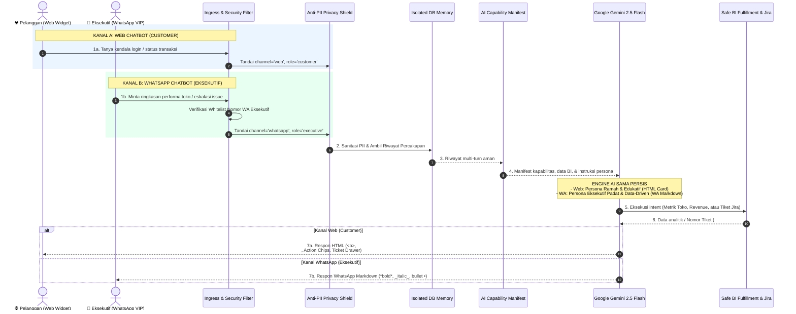

# 📱 PANDUAN ARSITEKTUR & IMPLEMENTASI: CHATBOT WHATSAPP KHUSUS EKSEKUTIF & NOTIFIKASI SISKEUDES TNT

<div align="center">
  
  <h3>Asisten Digital Siskeudes TNT & Executive Gateway</h3>
  <p><b>iMD IMTEK MEDIA DATA</b> &bull; Arsitektur Headless Orchestration & Multi-Channel Ingress</p>
</div>

Dokumentasi resmi pemenuhan kebutuhan kustomisasi chatbot: **"Satu flow orkestrasi yang sama untuk saluran Web (Asisten Siskeudes TNT) dan WhatsApp (Dua Arah Khusus Eksekutif & Zero-Spam Notification untuk Pelapor)"**.

---

## 🏛️ 1. Latar Belakang & Konsep Arsitektur

### Pertanyaan Kunci Customer:
> *"Bisakah membuat opsi chatbot dalam bentuk WhatsApp tetapi menggunakan flow yang sama? Bedanya: satu untuk web (customer/end-user), dan satunya untuk WhatsApp (yang digunakan oleh eksekutif)?"*

### Jawaban Arsitektural:
**BISA, dan ini adalah implementasi standar enterprise yang paling ideal (*Best Practice*)!** 

Sistem ini dirancang dengan pola **Headless Orchestrator & Manifest-Driven Engine** menggunakan **n8n + Google Gemini 2.5 Flash + Laravel Core API**. Artinya, otak AI, basis data kapabilitas, pemantauan token, sanitasi Anti-PII, serta integrasi Jira Service Desk **berada di satu titik pusat (*Single Source of Truth*)**. 

Strategi kanal WhatsApp dibagi secara tegas menjadi 2 mode untuk menjamin efisiensi biaya dan bebas risiko *rate-limit*:
1. **Kanal Eksekutif (Two-Way Interactive)**: Komunikasi dua arah dengan AI Assistant khusus pimpinan/direksi yang nomornya terdaftar di *Executive Whitelist*.
2. **Kanal Pelapor Siskeudes TNT (Zero-Spam Event-Driven Notification)**: Notifikasi push terbatas (maksimal 2 pesan per tiket: Tanda Terima Awal + Magic Tracking Link, dan Hasil Penyelesaian Solved). Follow-up dialihkan ke **Web-First Tracking**.

Perbedaannya hanyalah pada **Kanal Masuk (*Ingress Channel*)**, **Persona Gaya Komunikasi (*Tone of Voice*)**, dan **Format Presentasi Balasan (*Channel-Adaptive Presentation Layer*)**.

---

## 🔄 2. Diagram Alur Universal (Web vs WhatsApp Eksekutif)



---

## ⚖️ 3. Perbandingan Komprehensif: Web (Customer) vs WhatsApp (Eksekutif)

| Dimensi Evaluasi | 🌐 Web Chatbot (Pelanggan Umum) | 📱 WhatsApp Chatbot (Eksekutif / C-Level) |
| :--- | :--- | :--- |
| **Sasaran Pengguna** | Pelanggan publik, pengunjung web, pengguna aplikasi | Direksi, C-Level, General Manager, Manajer Operasional |
| **Kanal Akses** | Widget melayang di browser (`chat-widget.js`) | Aplikasi WhatsApp (Mobile/Desktop) melalui nomor resmi |
| **Persona & Gaya Bicara** | Ramah, mendalam, memandu step-by-step (*Customer Service*) | Ringkas, *to-the-point*, data-driven (*Executive Assistant*) |
| **Format Presentasi Balasan** | HTML tag (`<b>`, `<br>`, Action Chips, Drawer Formulir) | WhatsApp Markdown (`*teks tebal*`, `_miring_`, `• bullet`, ```code```) |
| **Fokus Informasi Utama** | Panduan SOP (Login, Export, Pembayaran, FAQ) | *Executive Summary*, Tren Pertumbuhan, Metrik Finansial, KPI Toko |
| **Otorisasi & Keamanan** | Terbuka untuk umum / sesi login browser | **Whitelist Nomor WhatsApp Resmi** (Nomor tidak terdaftar otomatis ditolak) |
| **Eskalasi Tiket Gangguan** | Tingkat urgensi reguler (*Low / Medium / High*) | **VIP / Critical Urgent Escalation** langsung ke antrean Jira Service Desk |
| **Session Tracking** | Session ID browser / UUID Cookie (`conv-xxxx`) | Nomor WhatsApp Eksekutif (`wa_62812xxxx`) |
| **Perlindungan Anti-PII** | **AKTIF** (NIK, HP, PIN disamarkan) | **AKTIF** (Menjaga keamanan data sensitif eksekutif) |
| **Pemantauan Token AI** | Tercatat terpisah (`channel: 'web'`) | Tercatat terpisah (`channel: 'whatsapp'`, `role: 'executive'`) |

---

## 🛡️ 4. Fitur Keamanan Khusus Eksekutif: Whitelist & Direktori VIP

Data performa bisnis dan analitik revenue merupakan informasi strategis perusahaan. Oleh karena itu, saluran WhatsApp dilengkapi **2 Lapis Pengamanan Tambahan**:

1. **Whitelist Nomor Telepon Eksekutif (`require_whitelist=true`)**:
   - Hanya nomor WhatsApp jajaran pimpinan yang telah terdaftar di `.env` (`WHATSAPP_EXECUTIVE_WHITELIST`) yang diizinkan berinteraksi dengan AI.
   - Jika nomor asing atau karyawan non-eksekutif mengirimkan pesan, sistem otomatis menolak secara sopan:
     > 🔒 *Akses Terbatas: Executive AI Assistant*  
     > *Nomor WhatsApp Anda belum terdaftar dalam direktori eksekutif resmi perusahaan. Silakan hubungi Administrator IT.*
2. **Direktori Nama & Jabatan Otomatis (`WHATSAPP_EXECUTIVE_DIRECTORY`)**:
   - Sistem memetakan nomor pengirim secara otomatis ke profil resmi (misal: `628123456789` -> `Pak Budi Santoso (Direktur Utama)`).
   - Setiap balasan AI menyapa jajaran pimpinan dengan nama dan konteks jabatan yang sesuai.

---

## ⚙️ 5. Konfigurasi Lingkungan (`.env`)

Tambahkan variabel berikut pada file `.env` aplikasi Anda:

```env
# ------------------------------------------------------------------------------
# Konfigurasi WhatsApp Chatbot Khusus Eksekutif (Executive AI Assistant)
# ------------------------------------------------------------------------------
WHATSAPP_EXECUTIVE_ENABLED=true
WHATSAPP_PROVIDER=fonnte                     # Pilihan: fonnte, wablas, meta_cloud, generic
WHATSAPP_API_URL=https://api.fonnte.com/send
WHATSAPP_API_KEY=your_fonnte_or_gateway_token

# Keamanan Akses: Batasi hanya nomor tertentu yang dapat bertanya
WHATSAPP_EXECUTIVE_REQUIRE_WHITELIST=true

# Daftar nomor WhatsApp eksekutif yang diizinkan (format 08... atau 628...)
WHATSAPP_EXECUTIVE_WHITELIST=08123456789,08198765432,628111222333

# Direktori profil nama & jabatan resmi pimpinan
WHATSAPP_EXECUTIVE_DIRECTORY=08123456789:Budi Santoso (Direktur Utama),08198765432:Siti Rahma (CFO),628111222333:Hendra (GM Operasional)

# Token verifikasi webhook (jika menggunakan Meta WhatsApp Cloud API)
WHATSAPP_WEBHOOK_VERIFY_TOKEN=secret_executive_token_2026
```

---

## 🧪 6. Cara Menguji & Mendemonstrasikan ke Customer

Untuk membuktikan kepada customer bahwa opsi ini telah siap pakai, tersedia **3 Cara Demonstrasi**:

### Cara 1: Buka Simulator Visual WhatsApp (Sangat Disukai Klien)
Buka file antarmuka di browser:
👉 **[package-frontend/whatsapp-executive-simulator.html](file:///home/soju/.gemini/antigravity-ide/scratch/chatbot/package-frontend/whatsapp-executive-simulator.html)**

- Tampilan smartphone WhatsApp asli (hijau khas WhatsApp, bubble pesan, centang ganda, profil terverifikasi).
- Pilih profil: *Pak Budi (CEO)*, *Ibu Siti (CFO)*, atau *Nomor Tak Dikenal* (untuk demonstrasi penolakan whitelist).
- Klik tombol 1-Click:
  - 📊 **Executive Summary**: Menyajikan ringkasan omzet, order, customer, dan saldo toko dalam format WhatsApp Markdown.
  - 📈 **Tren Revenue**: Menampilkan performa penjualan bulanan.
  - 🚨 **Eskalasi Insiden**: Menerbitkan tiket darurat Jira dengan status prioritas VIP.

### Cara 2: Melalui Script CLI Bash
Jalankan script mandiri dari root folder:
```bash
./test-whatsapp-executive.sh "Halo, sajikan ringkasan performa toko dan metrik earnings terkini"
```
Output terminal akan menampilkan deteksi intent, latensi, dan format WhatsApp Markdown yang dihasilkan.

### Cara 3: Melalui Artisan Command (Laravel CLI)
```bash
# Cek status konfigurasi gateway WhatsApp eksekutif
php artisan chatbot:whatsapp --test

# Uji simulasi pertanyaan eksekutif
php artisan chatbot:whatsapp --phone=628123456789 --message="Bagaimana performa revenue bulan April?"

# Uji kirim pesan langsung ke perangkat WhatsApp fisik
php artisan chatbot:whatsapp --send-test=628123456789
```

---

## 💬 7. Contoh Hasil Tampilan Obrolan

### A. Contoh Respon di WhatsApp Eksekutif (Lugas & WhatsApp Markdown)
```text
📊 *EXECUTIVE SUMMARY: PERFORMA BISNIS*
━━━━━━━━━━━━━━━━━━━━━━
• *Total Earnings*: *$559k (+16.24%)*
• *Total Orders*: *36,894 (-3.57%)*
• *Customers*: *183M (+29.08%)*
• *Saldo Kas*: *$165k*
• *Rasio Konversi*: *18%*
• *Aktivitas Terkini*: 7,585 orders ($22k earnings, 367 refunds)
━━━━━━━━━━━━━━━━━━━━━━
_Data tersinkronisasi real-time dari Core Database._
```

### B. Contoh Respon di Web Chatbot Pelanggan (Ramah & HTML Styling)
```html
📊 <b>Ringkasan Metrik Toko:</b><br>
• Total Earnings: <b>$559k (+16.24%)</b><br>
• Total Orders: <b>36,894 (-3.57%)</b><br>
• Customers: <b>183M (+29.08%)</b><br>
• Saldo Toko: <b>$165k</b><br>
• Rasio Konversi: <b>18%</b>
```

### C. Contoh Laporan Kendala Sistem oleh Eksekutif (Eskalasi VIP)
```text
🎫 *ESKALASI INSIDEN EKSEKUTIF: #TCK-20261027-4821*
━━━━━━━━━━━━━━━━━━━━━━
Yth. *Budi Santoso (Direktur Utama)*, kendala pada *Fitur: Transaksi Pembayaran* telah dicatat resmi dengan *PRIORITAS VIP*.

🌐 *Jira Service Desk*: Ditugaskan langsung ke antrean tim engineering (SUP).
🚨 *Alert Tim Teknis*: Notifikasi darurat telah dipancarkan ke Slack Tim Internal.

📋 *Rincian Kendala*:
• *No. Tiket*: `#TCK-20261027-4821`
• *Kategori*: Kendala Transaksi / Pembayaran
• *Urgensi*: *TINGGI (VIP ESCALATION)*
• *Status*: *OPEN / INVESTIGASI AKTIF*
━━━━━━━━━━━━━━━━━━━━━━
_Tim teknis segera menangani kendala ini dengan SLA percepatan._
```

---

## 📂 8. Ringkasan File Baru & Perubahan Terkait

1. **`package-backend/Services/WhatsAppFormatter.php`**: Layanan parsing konversi HTML ke WhatsApp Markdown standar.
2. **`package-backend/Services/ChatbotNotificationService.php`**: Penambahan method `sendWhatsAppMessage` untuk pengiriman pesan teks langsung.
3. **`package-backend/Controllers/WhatsAppWebhookController.php`**: Controller ingress webhook WhatsApp, verifikasi whitelist eksekutif, dan proxy ke n8n.
4. **`package-backend/Commands/ChatbotWhatsAppCommand.php`**: Perintah CLI `php artisan chatbot:whatsapp` untuk diagnosa dan simulasi.
5. **`package-backend/config/chatbot.php` & `.env.example`**: Konfigurasi `executive_whatsapp` (whitelist, direktori profil).
6. **`package-backend/routes/chatbot.php`**: Rute webhook `/webhook/whatsapp-entry` dan `/webhook/whatsapp-entry/simulate`.
7. **`n8n/universal-chatbot-workflow.json`**: Pembaruan node `Normalize Input`, `Build Gemini Prompt`, dan `Extract Response` yang adaptif terhadap kanal WhatsApp & role eksekutif.
8. **`package-frontend/whatsapp-executive-simulator.html`**: Simulator visual smartphone WhatsApp interaktif untuk demonstrasi klien.
9. **`test-whatsapp-executive.sh`**: Script bash CLI cepat untuk pengujian end-to-end.
