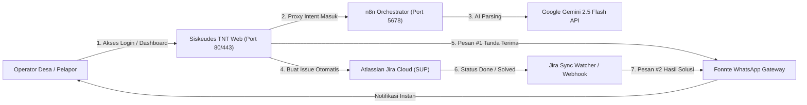

# 🚀 PANDUAN DEPLOYMENT RESMI: UNIVERSAL AI CHATBOT & HELPDESK SISKEUDES TNT
### Standar Operasional Prosedur (SOP) Deployment untuk Tim DevOps & System Administrator
**Target Sistem**: Live Project Siskeudes TNT (Aplikasi Transaksi Non-Tunai Kas Desa / `albba-master`)  
**Versi Chatbot**: 2.5 (Dual-Mode Login & Dashboard + Real-Time WhatsApp Lifecycle + 2-Way Jira)  
**Garansi Sistem**: **Zero Downtime & Zero Disruption** ke database transaksi desa (`tbspp`, `tbmdesa`, `tbmpemda`).

---

## 📋 DAFTAR ISI
1. [Ringkasan Arsitektur & Jaminan Keamanan](#1-ringkasan-arsitektur--jaminan-keamanan)
2. [Checklist Prasyarat Sistem (Prerequisites)](#2-checklist-prasyarat-sistem-prerequisites)
3. [Langkah 1: Konfigurasi Environment Variable (`.env`)](#3-langkah-1-konfigurasi-environment-variable-env)
4. [Langkah 2: Eksekusi Database Migration](#4-langkah-2-eksekusi-database-migration)
5. [Langkah 3: Sinkronisasi File Kode & Asset Frontend](#5-langkah-3-sinkronisasi-file-kode--asset-frontend)
6. [Langkah 4: Setup Background Watcher / Real-Time Jira Solved Sync](#6-langkah-4-setup-background-watcher--real-time-jira-solved-sync)
7. [Langkah 5: Import & Aktivasi Workflow n8n](#7-langkah-5-import--aktivasi-workflow-n8n)
8. [Langkah 6: Smoke Testing & Verifikasi Live](#8-langkah-6-smoke-testing--verifikasi-live)
9. [Prosedur Rollback & Troubleshooting](#9-prosedur-rollback--troubleshooting)

---

## 1. RINGKASAN ARSITEKTUR & JAMINAN KEAMANAN

Chatbot ini dirancang dengan prinsip **Non-Intrusive Decoupled Architecture**:
- **Zero Schema Interference**: Tabel chatbot (`chatbot_tickets`, `chatbot_conversation_messages`, `chatbot_token_usages`, `chatbot_kb_*`) bersifat independen. **TIDAK ADA Foreign Key** ke tabel transaksi desa, sehingga operasi database keuangan desa tidak akan pernah terblokir oleh aktivitas chat.
- **Dual-Mode Widget**:
  - **Halaman Login Publik (`login.blade.php`)**: Mode khusus pemulihan akses akun, lupa kata sandi, dan panduan SOP zero-token. Pengecekan data transaksi desa diblokir otomatis untuk mencegah kebocoran data (*Anti-Data Leakage*).
  - **Dashboard Internal Siskeudes TNT (`master.blade.php`)**: Mengisi otomatis data sesi operator, nama desa, pemda/kabupaten, dan tahun anggaran untuk pelaporan kendala transaksi non-tunai.
- **Anti-PII Protection Layer**: Data sensitif (Nomor KTP, Nomor HP, Password, PIN, Kartu Kredit) otomatis disaring (*redacted*) sebelum dikirim ke AI.
- **Zero-Spam WhatsApp Lifecycle**: Maksimal **2 pesan WhatsApp per tiket** ke nomor pelapor (Pesan #1: Tanda Terima & Magic Link, Pesan #2: Hasil Solusi saat status tiket di Jira berubah menjadi `Done`/`Resolved`).



---

## 2. CHECKLIST PRASYARAT SISTEM (PREREQUISITES)

Pastikan lingkungan live server telah memenuhi kualifikasi berikut:

| Komponen | Spesifikasi Minimum / Kebutuhan |
|---|---|
| **Web Server** | Nginx / Apache dengan PHP >= 7.4 (Direkomendasikan PHP 8.1 / 8.2) |
| **PHP Extensions** | `php-curl`, `php-json`, `php-pdo`, `php-openssl`, `php-mbstring` |
| **Database** | PostgreSQL >= 12 atau MySQL >= 5.7 / MariaDB >= 10.3 |
| **n8n Instance** | Docker container n8n aktif (bisa di server yang sama atau VM terpisah) |
| **Kredensial WhatsApp** | Akun Fonnte Gateway aktif dengan device terhubung (*connected*) |
| **Kredensial Jira** | Akun Atlassian Jira Cloud dengan API Token & akses ke Project `SUP` |
| **Process Manager** | Supervisor / Systemd (untuk menjalankan Jira Realtime Watcher) |

---

## 3. LANGKAH 1: KONFIGURASI ENVIRONMENT VARIABLE (`.env`)

Buka file `.env` pada root project Siskeudes TNT di live server:

```bash
nano /var/www/siskeudes-tnt/.env
```

Tambahkan blok konfigurasi chatbot berikut pada bagian akhir file:

```env
# ==============================================================================
# 🤖 UNIVERSAL AI CHATBOT & REALTIME WHATSAPP HELPDESK CONFIGURATION
# ==============================================================================

# 1. ORKESTRATOR N8N & INTERNAL SECURITY
N8N_WEBHOOK_URL=http://127.0.0.1:5678/webhook/chat-entry
CHATBOT_TIMEOUT_SECONDS=30
INTERNAL_API_KEY=KunciRahasiaInternalChatbot2026_UbahIniDiProduksi

# 2. WHATSAPP GATEWAY (FONNTE PROVIDER)
WHATSAPP_EXECUTIVE_ENABLED=true
WHATSAPP_PROVIDER=fonnte
WHATSAPP_API_URL=https://api.fonnte.com/send
WHATSAPP_API_KEY=RA2tadnBduwW7sZ9Lq44
WHATSAPP_WEBHOOK_VERIFY_TOKEN=chatbot_secret_token_live

# 3. JIRA SERVICE MANAGEMENT (PROJECT SUP)
JIRA_ENABLED=true
JIRA_HOST=imtekservice.atlassian.net
JIRA_PROJECT_KEY=SUP
JIRA_USER_EMAIL=clashroyaledeco@gmail.com
JIRA_API_TOKEN=ATATT3xFfGF0ZgrKeTKJJfqc4o9GS2xxAfkiVCxkhQ2yMX4FU3L_ukVwVFxk6tBEeqUMSmM_jdd_lXK-uo1b6XHcPmI5rVq867wih-q_y_-uxbnUyH3OrKDPomDpoDIW_RQVBPkSOmNs_AsW7cjD4jqwLKcpMyPZa1lCugdk_dpgl82tubvdxQ8=F678946B
JIRA_ISSUE_TYPE=Task

# 4. OPTIONAL: NOTIFIKASI BROADCAST INTERNAL TIM TEKNIS (SLACK / TELEGRAM)
SLACK_NOTIFICATIONS_ENABLED=false
SLACK_WEBHOOK_URL=
SLACK_CHANNEL=#customer-tickets
TELEGRAM_NOTIFICATIONS_ENABLED=false
TELEGRAM_BOT_TOKEN=
TELEGRAM_CHAT_ID=

# 5. ISOLASI DATABASE (Kosongkan jika menggunakan DB utama dengan prefix aman)
DB_CHATBOT_CONNECTION=
```

> [!IMPORTANT]
> - Ganti `INTERNAL_API_KEY` dengan string acak panjang dan pastikan nilai yang sama diisi pada node environment n8n.
> - Pastikan nomor pengirim di akun Fonnte (`089664744020`) berada dalam status **Connected**.

Simpan file, lalu bersihkan cache konfigurasi Laravel:
```bash
php artisan config:clear
php artisan cache:clear
```

---

## 4. LANGKAH 2: EKSEKUSI DATABASE MIGRATION

Migrasi chatbot telah dilengkapi pengecekan keberadaan tabel (`if (!Schema::hasTable)`), sehingga **100% aman dijalankan pada database produksi**:

```bash
php artisan migrate --force
```

Periksa apakah seluruh tabel chatbot telah terbentuk dengan benar:
```bash
php artisan migrate:status | grep -E "chatbot|ticket"
```

Tabel-tabel yang terbentuk:
1. `chatbot_tickets` (Menyimpan data tiket, tracking token, status, dan riwayat notifikasi)
2. `chatbot_conversation_messages` (Menyimpan riwayat percakapan bebas PII)
3. `chatbot_token_usages` (Mencatat konsumsi token Gemini LLM)
4. `chatbot_kb_categories` & `chatbot_kb_templates` (Knowledge Base SOP dinamis)
5. `chatbot_kb_sync_logs` (Audit trail sinkronisasi pengetahuan)

---

## 5. LANGKAH 3: SINKRONISASI FILE KODE & ASSET FRONTEND

Pastikan file-file berikut telah disinkronkan ke live project (melalui Git Pull atau copy artifact):

### A. Backend Services & Controllers:
```
app/
├── Services/
│   ├── ChatbotNotificationService.php  (Dispatch WA #1 Tanda Terima & WA #2 Solved via Fonnte)
│   ├── JiraService.php                 (Integrasi REST API Jira Cloud, ADF Parser & Sync)
│   ├── PiiSanitizer.php                (Anti-PII Privacy Shield)
│   ├── WhatsAppFormatter.php           (Parser Markdown WhatsApp)
│   └── TemplateDeduplicationService.php
├── Http/
│   ├── Controllers/Api/
│   │   ├── TicketReportController.php  (Submit Laporan, Track Link, SPP Lookup, Webhook)
│   │   ├── AiCapabilityController.php
│   │   ├── ConversationMemoryController.php
│   │   ├── TokenUsageController.php
│   │   └── WhatsAppWebhookController.php
│   └── Middleware/
│       └── VerifyInternalApiKey.php
└── Console/Commands/
    └── ChatbotJiraCommand.php          (Command sinkronisasi Jira & WhatsApp Solved)
```

### B. Routes & Configuration:
```
config/
├── chatbot.php                         (Konfigurasi channel & integrasi)
└── ai_registry.php                     (Knowledge Base SOP Kemendagri / BPKP)

routes/
└── chatbot.php                         (Terpanggil otomatis via routes/api.php)
```

### C. Blade Views & Frontend Assets:
```
resources/views/
├── chatbot/
│   └── widget.blade.php                (Komponen adaptif dual-mode: login vs dashboard)
└── layouts/
    ├── login.blade.php                 (Include @include('chatbot.widget') sebelum </body>)
    └── master.blade.php                (Include @include('chatbot.widget') sebelum </body>)

public/vendor/chatbot/
├── chat-widget.js                      (Script widget 72KB terbaru dengan adaptive drawer)
├── chat-widget.css                     (Style widget & tombol responsive)
└── assets/
    └── logo-siskeudes-tnt.png          (Logo resmi Siskeudes TNT)
```

Pastikan permission direktori public dapat dibaca oleh Nginx:
```bash
chmod -R 755 public/vendor/chatbot/
chown -R www-data:www-data public/vendor/chatbot/
```

---

## 6. LANGKAH 4: SETUP BACKGROUND WATCHER / REAL-TIME JIRA SOLVED SYNC

Agar Pesan WhatsApp #2 (Solved) terkirim secara **real-time** saat teknisi menekan tombol **"Mark as Done"** di Jira Cloud, tim DevOps dapat memilih salah satu metode di bawah ini:

### 🌟 Opsi A (Direkomendasikan): Setup Daemon via Supervisor
Metode ini paling andal, otomatis berjalan saat server restart, dan langsung me-restart proses jika terjadi crash.

1. Install supervisor (jika belum ada):
   ```bash
   sudo apt-get install supervisor -y
   ```

2. Buat file konfigurasi supervisor:
   ```bash
   sudo nano /etc/supervisor/conf.d/siskeudes-jira-watcher.conf
   ```

3. Isi dengan konfigurasi berikut:
   ```ini
   [program:siskeudes-jira-watcher]
   process_name=%(program_name)s_%(process_num)02d
   command=php /var/www/siskeudes-tnt/artisan chatbot:jira --watch --interval=15
   autostart=true
   autorestart=true
   user=www-data
   numprocs=1
   redirect_stderr=true
   stdout_logfile=/var/www/siskeudes-tnt/storage/logs/jira-watcher.log
   stdout_logfile_maxbytes=20MB
   stdout_logfile_backups=5
   ```

4. Muat dan jalankan daemon:
   ```bash
   sudo supervisorctl reread
   sudo supervisorctl update
   sudo supervisorctl start siskeudes-jira-watcher:*
   ```

5. Cek status daemon:
   ```bash
   sudo supervisorctl status siskeudes-jira-watcher:*
   ```

---

### Opsi B: Setup Cron Job (Alternatif Sederhana)
Jika server tidak mengizinkan penambahan daemon Supervisor, gunakan cron job yang berjalan setiap menit:

Buka crontab user web server (`crontab -e`):
```cron
* * * * * cd /var/www/siskeudes-tnt && php artisan chatbot:jira --sync >> /dev/null 2>&1
```

---

### Opsi C: Direct Push Jira Webhook (Jika Memiliki Domain Publik)
Bila live server memiliki domain publik yang dapat diakses langsung oleh Atlassian (misal: `https://tnt.bankbpd.co.id`):
```bash
php artisan chatbot:jira --register-webhook=https://tnt.bankbpd.co.id
```
*Perintah ini otomatis mendaftarkan webhook URL ke Jira REST API tanpa perlu login manual ke dashboard Jira.*

---

## 7. LANGKAH 5: IMPORT & AKTIVASI WORKFLOW N8N

1. Buka dashboard n8n produksi (misal: `http://ip-server:5678`).
2. Masuk ke menu **Workflows** ➔ klik tombol **Import from File**.
3. Pilih file `universal-chatbot-workflow.json`.
4. Pastikan variabel environment pada container n8n telah diisi:
   - `BACKEND_BASE_URL`: URL internal/eksternal Siskeudes TNT (contoh: `http://siskeudes-app:80` atau `http://127.0.0.1:8000`).
   - `INTERNAL_API_KEY`: Samakan dengan nilai `INTERNAL_API_KEY` di file `.env` Siskeudes TNT.
   - `GEMINI_API_KEY`: API Key Google AI Studio. Mendukung multi-key dipisahkan koma untuk rotasi otomatis jika terkena rate limit (429):
     `GEMINI_API_KEYS=AIzaSyA...,AIzaSyB...,AIzaSyC...`
5. Ubah status workflow menjadi **Active** (toggle saklar di kanan atas menjadi hijau).

---

## 8. LANGKAH 6: SMOKE TESTING & VERIFIKASI LIVE

Lakukan 5 langkah pengujian cepat untuk memastikan seluruh alur berjalan sempurna di produksi:

### Test 1: Uji Koneksi Jira Service Management
Jalankan dari terminal live project:
```bash
php artisan chatbot:jira --test
```
*Ekspektasi Output*: Muncul tabel hijau dengan status **✓ KONEKSI KE JIRA SERVICE MANAGEMENT BERHASIL!** pada Project `SUP`.

---

### Test 2: Uji Tampilan Widget di Halaman Login Publik
1. Buka browser pada URL login Siskeudes TNT (misal: `https://domain-siskeudes.id/login`).
2. Pastikan bubble logo Siskeudes TNT muncul di pojok kanan bawah.
3. Klik tombol bubble:
   - Judul harus tertulis: **"Helpdesk Login Siskeudes TNT"**.
   - Tab yang aktif otomatis: **"🔑 Kendala Login"** (form ringkas hanya meminta Akun, No WA, Jenis Kendala, dan Deskripsi).
   - Pastikan field transaksi seperti SPP/Kwitansi disembunyikan demi privasi.

---

### Test 3: Uji Tampilan Widget di Dashboard Setelah Login
1. Login sebagai operator salah satu desa.
2. Buka dashboard Siskeudes TNT.
3. Klik bubble chatbot:
   - Judul harus tertulis: **"Asisten Digital Siskeudes TNT"**.
   - Input nama desa dan kabupaten pada drawer otomatis terisi (*auto-filled*) sesuai instansi desa yang login.
   - Fitur pengecekan SPP dan tombol SOP Kemendagri / BPKP aktif.

---

### Test 4: Uji Realtime WhatsApp #1 (Tanda Terima & Magic Link)
Kirim laporan kendala uji coba menggunakan curl:
```bash
curl -s -X POST http://127.0.0.1:8000/api/v1/tickets/public-submit \
  -H "Content-Type: application/json" \
  -d '{
    "user_id": "operator_live_test",
    "user_name": "DevOps Live Test",
    "reporter_phone": "08xxxxxxxxxx",
    "kabupaten": "Kabupaten Pengujian",
    "nama_desa": "Desa Uji Coba",
    "category": "akun",
    "feature_name": "Autentikasi & Login Siskeudes TNT",
    "description": "Pengujian live WhatsApp Pesan 1 dan 2",
    "urgency": "tinggi",
    "channel": "web"
  }'
```
*Ekspektasi Output*:
- Respon JSON mengembalikan `"status": "success"` dengan nomor tiket `#TCK-...` dan `jira_key: "SUP-xx"`.
- Nomor WhatsApp pelapor seketika menerima **Pesan #1** berisi tanda terima resmi dan tautan Magic Link pemantauan mandiri.

---

### Test 5: Uji Realtime WhatsApp #2 (Solved / Penyelesaian)
1. Buka Atlassian Jira Cloud (`https://imtekservice.atlassian.net/browse/SUP-xx`).
2. Buka issue yang baru saja dibuat di Test 4.
3. Ubah status issue menjadi **Done / Selesai**, dan berikan komentar solusi.
4. Dalam waktu <= 15 detik, periksa WhatsApp pelapor:
   - Pelapor menerima **Pesan #2** yang memuat:
     - Nomor tiket `#TCK-...`.
     - Status: `RESOLVED / SELESAI`.
     - Teks kutipan solusi teknisi yang baru saja Anda ketikkan di Jira.

---

## 9. PROSEDUR ROLLBACK & TROUBLESHOOTING

### Cara Menonaktifkan Chatbot Secara Instan (Emergency Killswitch)
Jika terjadi kondisi darurat di produksi dan Anda ingin menyembunyikan widget tanpa deploy ulang:
Cukup ubah baris di `resources/views/layouts/login.blade.php` dan `master.blade.php`:
```blade
{{-- Matikan sementara dengan comment tag blade: --}}
{{-- @include('chatbot.widget') --}}
```
Lalu jalankan `php artisan view:clear`. Widget langsung hilang dari browser pengguna dalam 1 detik.

---

### Troubleshooting Kasus Umum

| Gejala Masalah | Penyebab Utama | Solusi Penanganan |
|---|---|---|
| **Pesan WA #1 tidak terkirim** | Kuota Fonnte habis atau device disconnect. | Buka dashboard Fonnte, cek menu *Device*. Pastikan statusnya `Connect`. Cek log di `storage/logs/laravel.log`. |
| **Pesan WA #2 tidak terkirim saat tiket Done** | Daemon watcher Supervisor mati atau issue belum berstatus Done. | Cek status dengan `supervisorctl status siskeudes-jira-watcher:*`. Cek log watcher di `storage/logs/jira-watcher.log`. |
| **Widget chat loading terus saat mengirim pesan** | Port n8n (5678) tidak dapat dihubungi oleh backend PHP. | Periksa apakah container n8n berjalan (`docker ps`). Uji koneksi dari server dengan `curl http://127.0.0.1:5678/healthz`. |
| **CORS atau CSP Header Block pada browser** | Header `Content-Security-Policy` memblokir script lokal. | Karena script berada di `public/vendor/chatbot/`, pastikan header CSP Nginx mengizinkan `'self'`. |

---
**Dokumentasi ini disiapkan oleh Tim Pengembang Chatbot iMD untuk Tim DevOps Siskeudes TNT.**  
Jika terdapat pertanyaan atau kendala saat deployment, silakan merujuk pada log sistem di `storage/logs/laravel.log`.
